# Getting started with BusyStack CalDAV Server

This is the complete operator, administrator and user guide for BusyStack 0.2.0.
Release packages replace `@VERSION@` below with their exact version. When reading
this file in the source repository, substitute `0.2.0` for that placeholder.
Only download a version whose official release assets are available.

## 1 — What BusyStack does

BusyStack stores calendars and task lists on a server you control. CalDAV is the
protocol that compatible calendar applications use to discover and synchronize
those collections. Edit events and tasks in a connected application, such as
Thunderbird. The web portal manages accounts, collections, sharing, application
access, security, and iCalendar import/export; it is not an event or task editor.

Standalone operation needs no Keycloak, email delivery, cloud service, vendor
account, telemetry, analytics, licensing server, or remote frontend assets.
Your database and backups contain your data; control access to both.

## 2 — Requirements

The release container distribution supports **Linux AMD64**, Docker Engine, and
**Docker Compose 2.24.4 or newer**. Other operating systems and architectures are
not qualified by these instructions. Check the host before downloading:

```sh
uname -s -m
docker version
docker compose version
```

Expect `Linux x86_64`, a responding Docker server, and an adequate Compose version.
Your operator account needs access to Docker; that access controls this server.
The command examples also use a shell, curl, tar, sha256sum, OpenSSL and standard
Linux file utilities. No host Java, Maven, source checkout or compilation is
needed. The image supplies Java 25, Spring Boot and the application. Compose
supplies private PostgreSQL 18.6.

Provide persistent disk space for PostgreSQL, growing calendar/synchronization
history and separate backups. No measured minimum host RAM/disk specification is
published. The application container has a 1 GiB memory limit and a 384 MiB `/tmp`
allocation; those defaults are not a whole-host capacity guarantee. PostgreSQL,
Docker, the proxy and backups need additional resources. Monitor usage.

Provide a stable hostname, appropriate DNS, and a trusted HTTPS certificate and
private key matching that hostname. A private deployment may use its own CA only
when every client trusts that CA normally. The package does **not** obtain public
certificates automatically. Supply and maintain the HTTPS reverse proxy yourself;
working Nginx configurations are included. Certificate issuance, DNS and firewall
administration remain operator responsibilities.

Allow HTTPS from intended clients to the proxy. Allow outbound access needed to
download release assets and pinned images. Do not expose PostgreSQL or the internal
HTTP listener publicly. The supplied Compose binds application HTTP to loopback
and publishes no PostgreSQL port. Use persistent volumes, protected configuration,
and secure local operator access. Keep time correct for TLS, expiry and passkeys.

## 3 — Download and verify

Choose an official version. In a new directory, run:

```sh
VERSION=@VERSION@
curl -fLO "https://github.com/busystack/caldav-server/releases/download/v${VERSION}/caldav-server-${VERSION}-deploy.tar.gz"
curl -fLO "https://github.com/busystack/caldav-server/releases/download/v${VERSION}/SHA256SUMS"
curl -fLO "https://github.com/busystack/caldav-server/releases/download/v${VERSION}/release-manifest.json"
sha256sum --check --ignore-missing SHA256SUMS
tar -xzf "caldav-server-${VERSION}-deploy.tar.gz"
cd "caldav-server-${VERSION}-deploy"
```

Continue only when the archive and `release-manifest.json` report `OK`, with no
checksum failure. Other assets not downloaded are skipped. Checksums detect
corruption; obtain them from the official immutable release, whose attestation
binds the publisher's assets. The manifest records source, JAR checksum, tested
image identity and qualification evidence. Do not run unverified remote scripts.

All remaining deployment commands run **inside this extracted directory** unless
stated otherwise. It contains `INSTALL.md`, this guide and screenshots, Compose,
proxy examples and scripts. Its Compose pulls the published version **and immutable
registry digest**. Preserve that identity; do not substitute `latest` or a locally
built image for ordinary installation.

## 4 — Configure the server

```sh
cp .env.example .env
install -d -m 700 "$HOME/.config/busystack-caldav"
(umask 077; openssl rand -base64 48 > "$HOME/.config/busystack-caldav/database-password")
(umask 077; openssl rand -base64 48 > "$HOME/.config/busystack-caldav/postgres-admin-password")
chmod 444 "$HOME/.config/busystack-caldav/database-password" "$HOME/.config/busystack-caldav/postgres-admin-password"
```

Use new secret files for a new installation; do not overwrite secrets belonging
to an existing deployment. OpenSSL generates the two independent passwords.
Never paste them into `.env`, process arguments, browser pages, Git or logs.
The containing directory stays mode 0700; file mode 0444 lets the non-root
container users read bind-mounted Compose secrets without exposing them to other
host users through that private directory. Do not make the directory public.
Protect backups of configuration and secrets separately from database backups.

Edit `.env` with your values. For a hostname-root installation:

```dotenv
BUSYSTACK_PUBLIC_BASE_URL=https://calendar.example.org
BUSYSTACK_ISSUER=https://calendar.example.org
BUSYSTACK_DATABASE_PASSWORD_FILE=/home/OPERATOR/.config/busystack-caldav/database-password
BUSYSTACK_POSTGRES_ADMIN_PASSWORD_FILE=/home/OPERATOR/.config/busystack-caldav/postgres-admin-password
BUSYSTACK_HTTP_PORT=8080
```

Replace the hostname and both absolute paths. Shell expressions such as `$HOME`
are not a substitute for writing the intended absolute paths here. Public URL
and OAuth issuer must be equal, without trailing slash, query or fragment. These
are externally visible HTTPS addresses, not container network addresses.

For a subpath, set **both** URLs to `https://calendar.example.org/calendar` and use
`nginx-subpath.conf.example`. The application derives its servlet prefix from this
configuration. The proxy must preserve `/calendar`; it must not strip the prefix.
It must also handle host-root discovery using the supplied explicit mappings.
Use canonical ASCII prefixes. Choose the hostname deliberately: changing it can
make previously registered passkeys unusable.

Use [the complete root proxy example](../deployment/nginx-root.conf.example) or
[the complete subpath proxy example](../deployment/nginx-subpath.conf.example) in an extracted
package. In the source repository these examples are in `deployment/`. Replace
`calendar.example.org`, certificate paths and, if changed, loopback upstream port.
Install the chosen example through your existing Nginx administration procedure;
run `sudo nginx -t` before reloading it. Both examples restrict health endpoints,
disable compression, and supply the larger bounded import route. Do not enable
blanket forwarded-header trust. [Operations](operations.md#https-and-proxy-paths)
explains the configuration and other operator considerations.

PostgreSQL data lives in the Compose `database` volume at `/var/lib/postgresql`.
Initialization scripts only run on an empty volume. Changing a secret file later
does not change an existing database role password; rotate the role and file
together during controlled maintenance.

For an isolated trial, set a new `COMPOSE_PROJECT_NAME` and unused
`BUSYSTACK_HTTP_PORT` in `.env` before the first Compose command. Point the trial's
proxy at that port. Never use a production project's volume for a trial or restore.

## 5 — Start BusyStack

```sh
docker compose config --quiet
docker compose pull --policy missing
docker compose up -d --no-build --wait --wait-timeout 240
docker compose ps
```

Configuration validation must exit successfully. Pull must obtain the configured
pinned images. PostgreSQL becomes healthy before the application starts; application
readiness includes database connectivity. Both services should show healthy.

Check actual HTTPS, including the configured subpath if any:

```sh
curl --fail --show-error --silent --location --output /dev/null https://calendar.example.org/
curl --head https://calendar.example.org/.well-known/caldav
```

For a `/calendar` deployment, use `https://calendar.example.org/calendar/` in the
first command. Discovery should redirect to the configured `/calendar/dav/`.
Check certificate validity and hostname with normal validation; do not use `-k`.
Open the public URL in a browser. A fresh database must show **Set up BusyStack**.
A running container alone does not prove DNS, HTTPS, proxy paths or isolation.

Inspect listeners with your host's network tools, for example `ss -ltn`.
The application port should be `127.0.0.1:8080` (or your selected loopback port),
with no published database port. Check the host firewall from a permitted client.
Use `docker compose logs --tail 100 application database` for startup diagnostics;
keep diagnostic output private and never enable request-body/credential logging.
See chapter 19 if startup or HTTPS fails.

## 6 — Create the first administrator

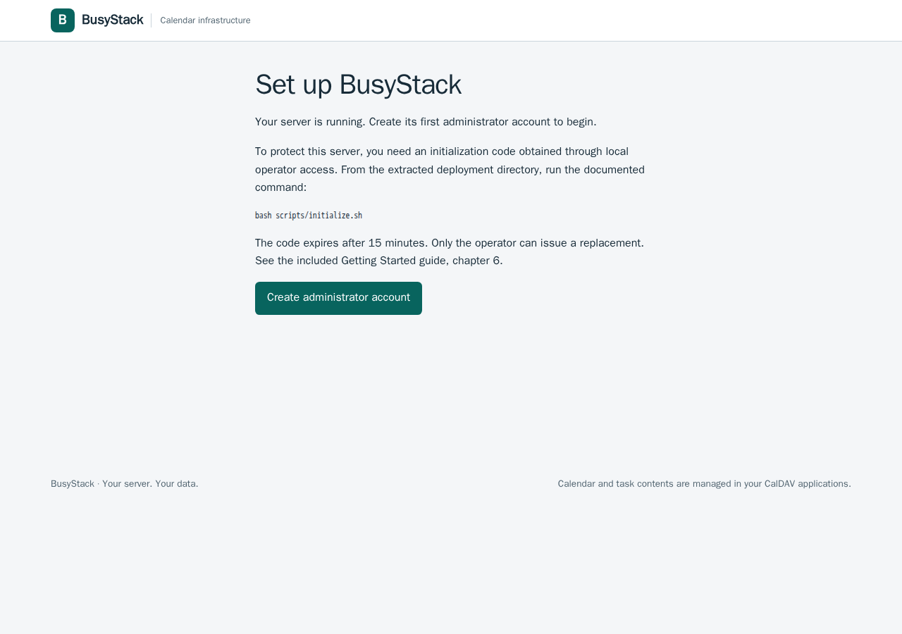

This page confirms the server is running and needs its first administrator. Merely
visiting it gives no administrative permission. With local access to the deployment
directory, issue a short-lived initialization code:

```sh
bash scripts/initialize.sh
```

This runs the installed application inside a one-off Compose container against
this deployment's database. No host Java is required. The command prints a code
valid for **15 minutes**, once, to the operator's terminal. Keep that terminal
private. Do not put the code in a URL, screenshot, chat, log file or shell history.
The long-running server never prints it. Every replacement invalidates the previous
code. After five invalid submissions, a fresh local code is required.

Choose **Create administrator account** in the browser.

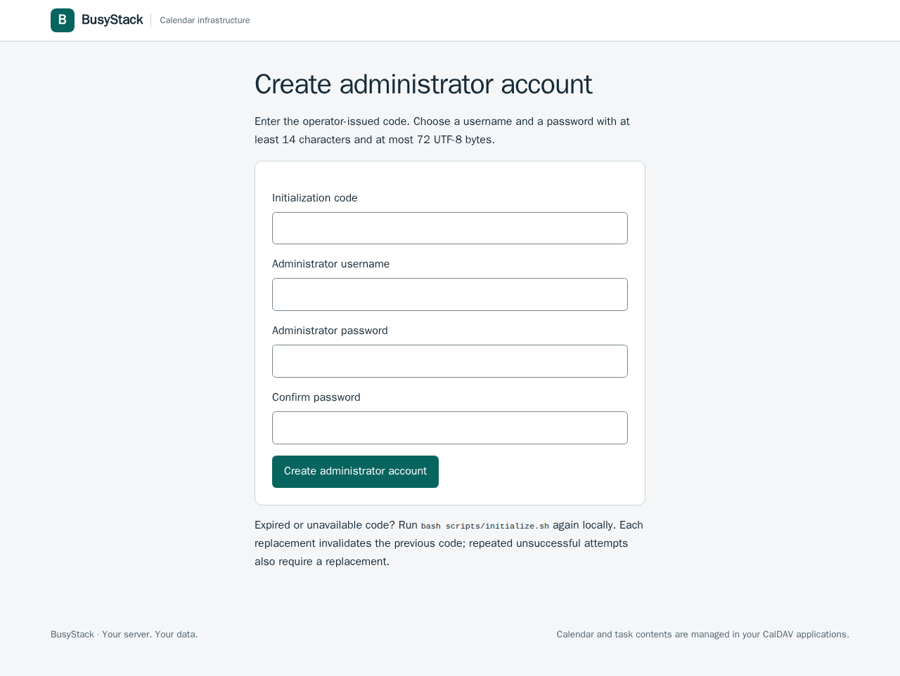

Enter the code, a username, a password and its confirmation. Usernames contain
1–64 letters, numbers, dots, underscores or hyphens, starting with a letter or
number. Passwords need at least **14 characters** and at most **72 UTF-8 bytes**;
some characters use more than one byte. Use your password manager to generate and
store a suitable password. Passwords and codes are never redisplayed after errors.

Submit **Create administrator account**. An expired or unavailable code requires
running `bash scripts/initialize.sh` again locally; no database reset is needed.

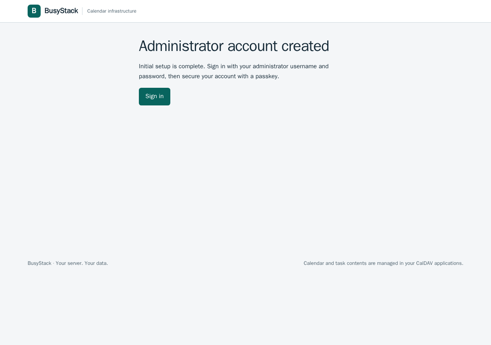

**Administrator account created** means setup is permanently closed for this
database. Choose **Sign in**. Setup does not sign you in automatically. Restart,
account disabling, or restoring this initialized database does not reopen setup.
Existing initialized installations go directly to normal login after upgrade.
Offline account recovery remains a separate controlled operation (chapter 16).

## 7 — Secure the administrator account

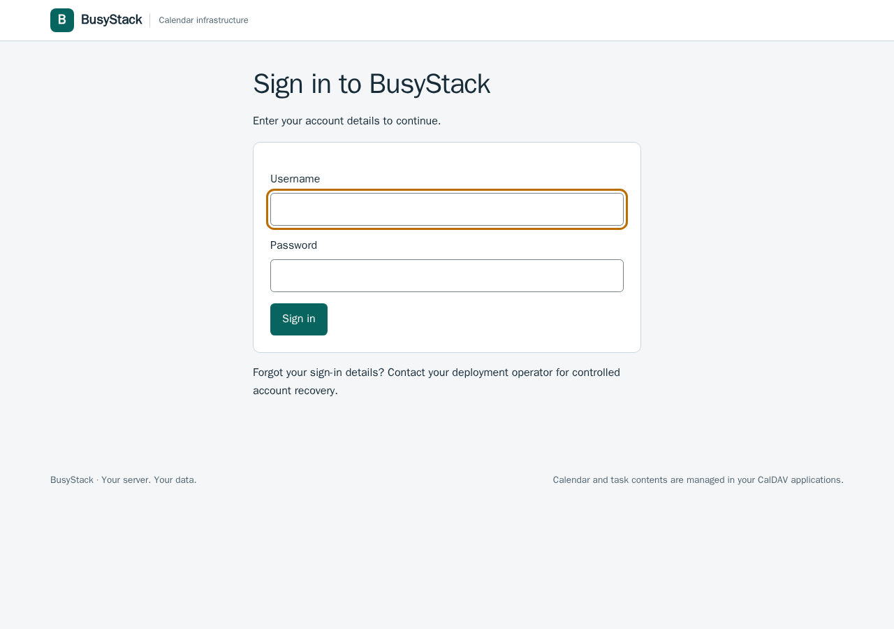

Sign in with the account you just created. You then see **Secure your account**.

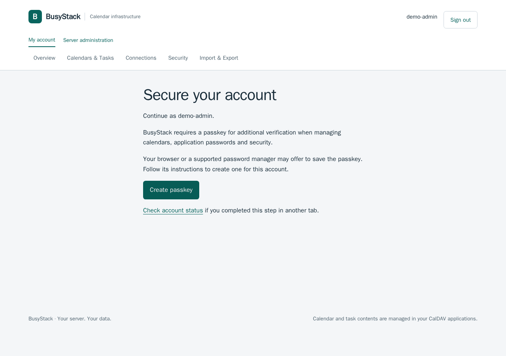

Choose **Create passkey**. Your browser or supported password manager offers its
normal passkey interface. Follow that interface. BusyStack does not require a
particular password manager, fingerprint reader or USB device. The passkey provider
must support the verification requested by the browser. No passkey name is required
for this first enrollment.

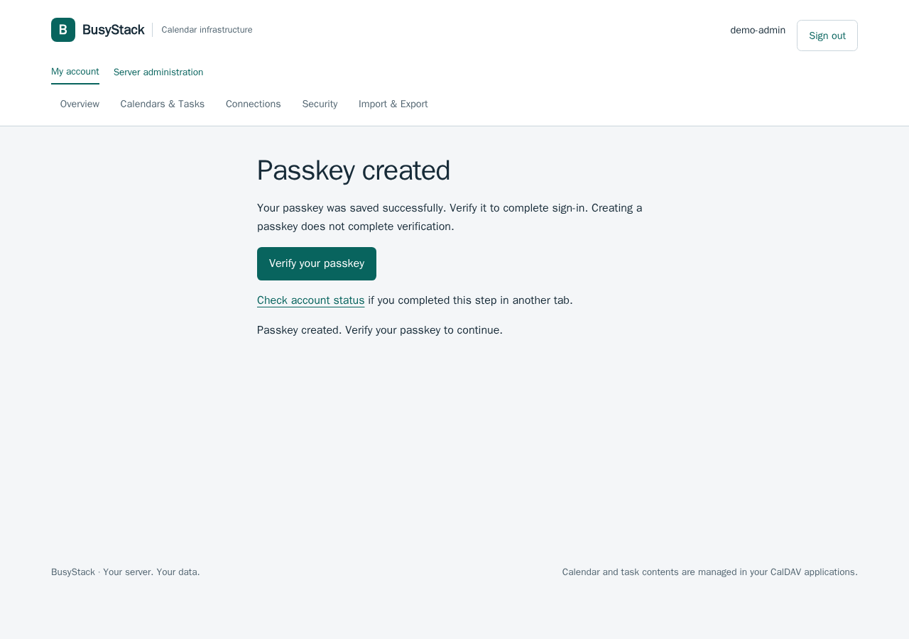

Wait for **Passkey created**, then choose **Verify your passkey**. Saving a passkey
and proving you can use it are separate steps; creating it alone does not authorize
sensitive operations.

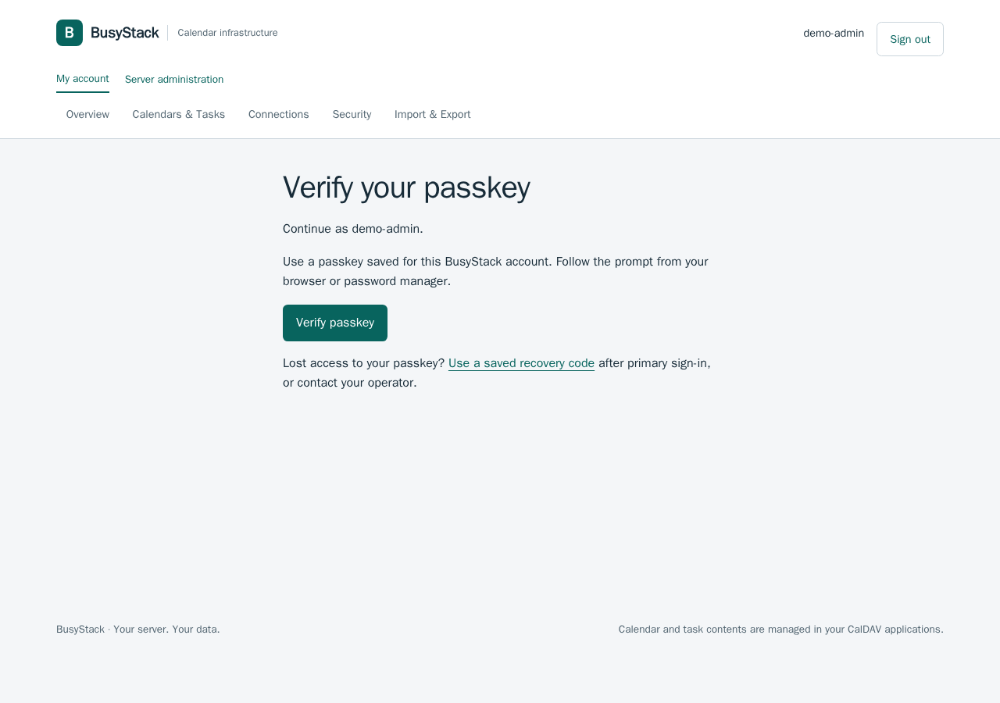

Choose **Verify passkey** and complete the provider's prompt using this account's
passkey. After **Authentication successful**, choose **Continue** to return to your
intended operation. Protected form submissions are not replayed automatically.
If a prompt does not finish, read the contextual status and retry when ready.
A browser `NotAllowedError` can mean cancellation, timeout or unavailable credentials;
it does not identify one exact cause. If a registration response was lost, BusyStack
checks authoritative enrollment state before suggesting another registration.

Primary sign-in and passkey verification must each be within **ten minutes** for
sensitive changes/downloads. A session can remain active after that interval;
follow the indicated sign-in or verification action when required. Returning users
sign in normally and verify their existing passkey; they do not enroll again.
A recovered account whose old passkeys were revoked enrolls a new one.

Open **Security → Recovery** after verification. Generate recovery codes through
the existing protected workflow, save them securely offline, then leave the one-time
screen. They provide a second-factor recovery path when you still have primary
sign-in. They do not replace a forgotten primary password. You may continue using
the service without generating them, but losing all factors then needs local
operator recovery. Chapter 13 explains recovery and revocation.

## 8 — Personal and organizational use

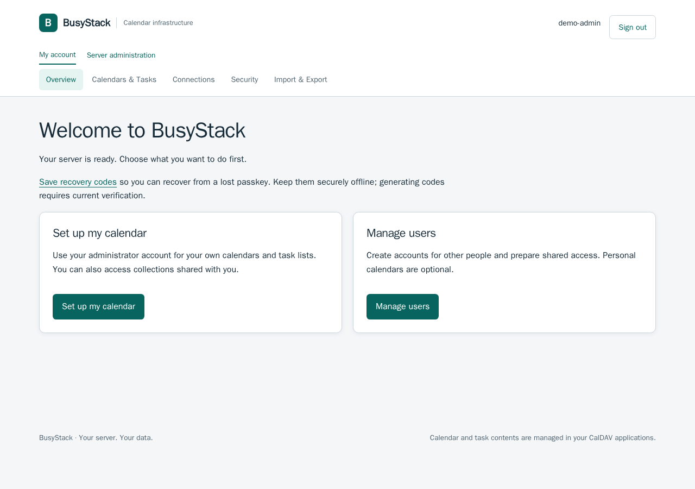

The first browser-created administrator sees **Welcome to BusyStack** after MFA.
Recovery codes are available from this screen. Choose one activity:

* **Set up my calendar** opens available collections. Use this same administrator
  account for personal calendars or shared collections; no separate account is needed.
* **Manage users** opens administrator account management. Create accounts for
  other people without creating a personal calendar first.

These are navigation choices, not account types or server modes. Completing a
choice dismisses this initial welcome. Returning administrators use the normal
portal, with **Server administration** always available according to their role.

## 9 — Manage users

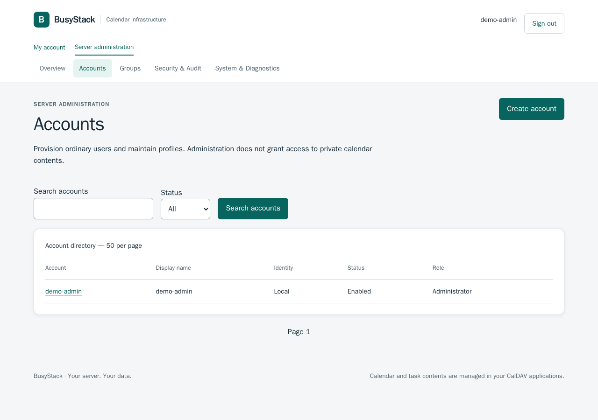

Open **Server administration → Accounts → Create account**.

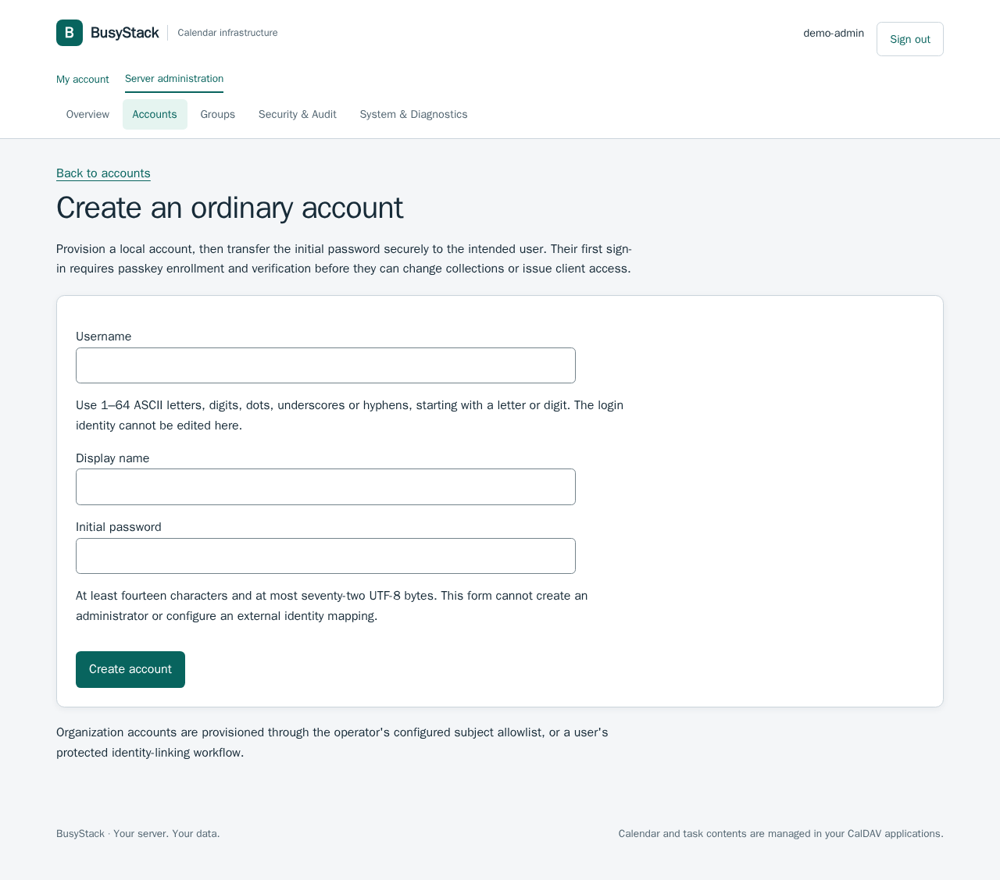

Supply username, display name and an initial password meeting the same policy.
Choose **Create account**. This creates an ordinary local account, not another
administrator. Transfer the URL, username and password through a secure channel
available to you, such as an approved password-manager sharing feature or direct
handoff. No email invitation service is required. Let the user enroll and verify
their own passkey; do not enroll it on their behalf.

Select an account to maintain its display name or disable it. Disabling requires
explicit confirmation and invalidates sessions and independently issued client
access while retaining stored data and membership. There is no public reactivation
or password-reset endpoint. Controlled recovery is described in chapter 16.

Use **Server administration → Groups** to create a group, add exact active usernames,
review membership consequences, rename it or confirm deletion. Membership affects
all collections granted to the group, including future grants. Owners decide which
collections to share. Removing one grant or membership may leave access supplied
by another grant; check effective permissions. [Groups](groups.md) has details.

Administrators manage accounts, membership, OAuth client registrations and safe
operational metadata. Administrator status does **not** automatically permit
reading other users' private calendars. Sharing and local account authorization
remain authoritative. Ordinary users do not see server-administration controls or
an unrestricted account directory.

## 10 — An ordinary user's first login

The administrator supplies your BusyStack URL and credentials. Open that HTTPS
URL, sign in, choose **Create passkey**, then verify it as in chapter 7. If your
organization manages primary sign-in, use its organizational sign-in instead;
local BusyStack passkeys still follow it.

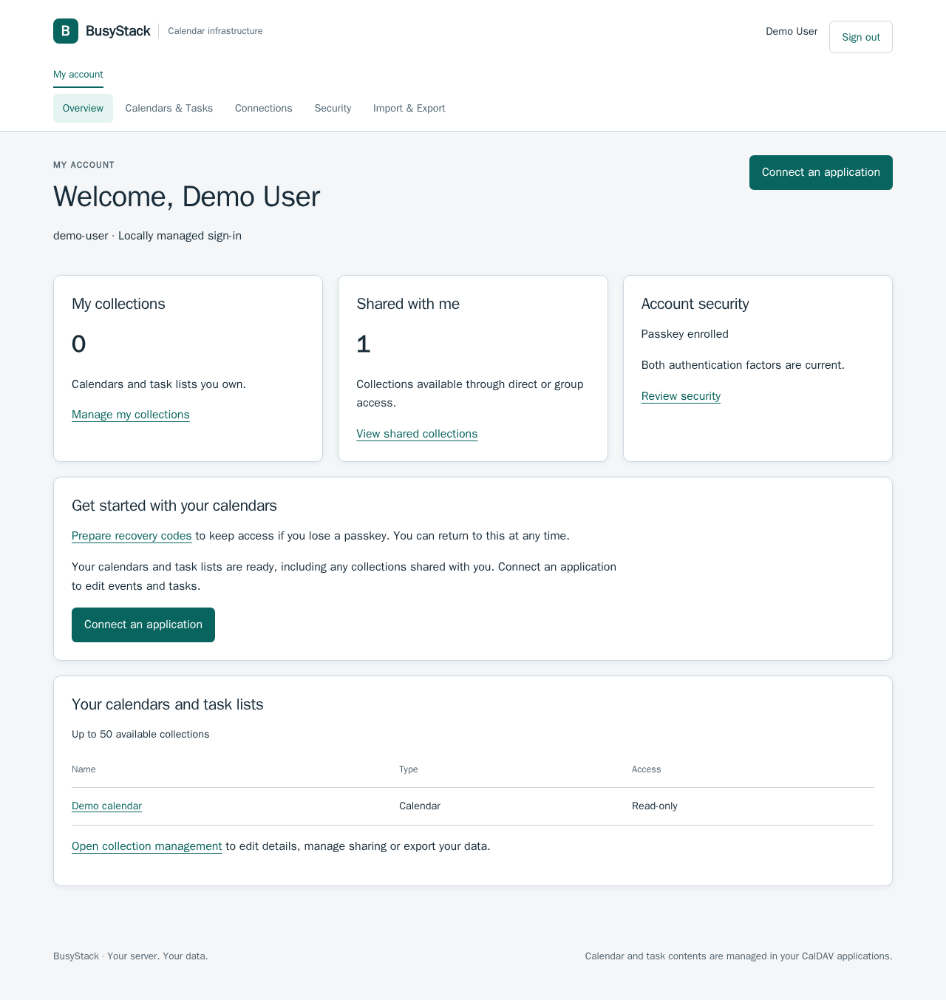

Prepare recovery codes under **Security → Recovery** if possible. The account
screen uses your actual collections and application-password state to offer the
next action. If you already have shared access, continue directly to
**Connect an application**. Otherwise create a calendar/task list, or ask an owner
to share one with your exact username. You do not have to duplicate shared data.
Account recovery can revoke previous passkeys and application access; follow the
same enrollment/verification sequence afterward.

## 11 — Calendars and tasks

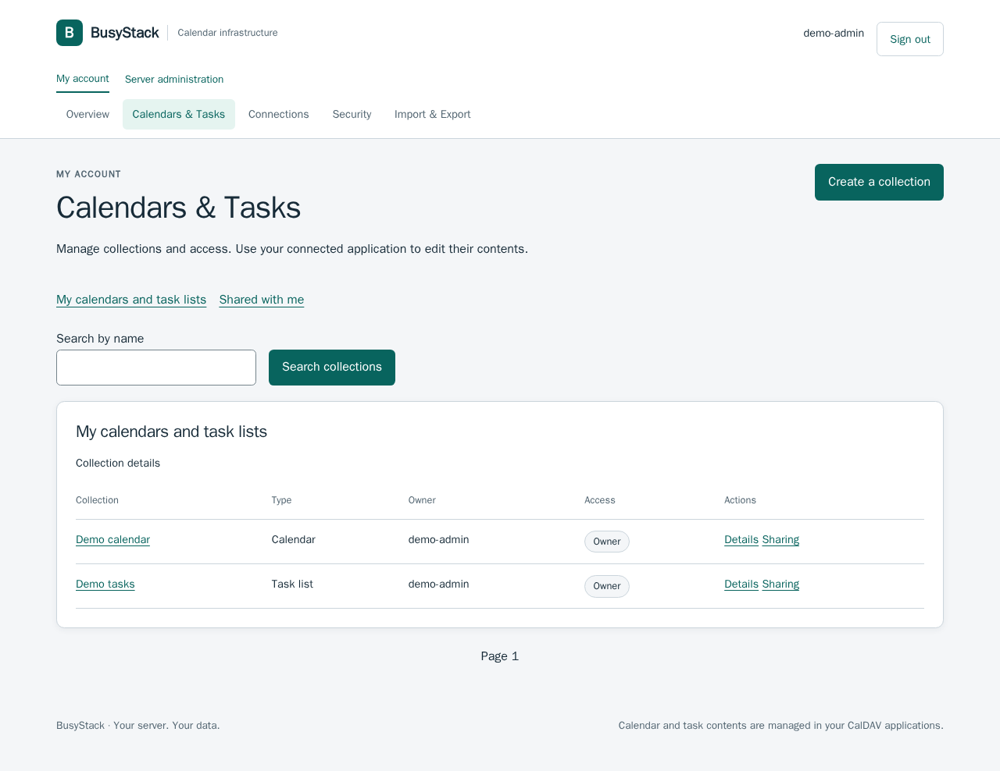

Open **Calendars & Tasks**. Use owned/shared filters and search. Choose
**Create a collection**, enter a name and choose **Calendar** for events or
**Task list** for tasks. Optional description and colour can help clients identify
it. Type is fixed after creation. Actual event/task editing occurs in a CalDAV app.
GNOME Calendar provides event editing; use a VTODO-capable application for tasks.

Select a collection to view its address, owner and access. Authorized read/write
recipients can edit shared metadata and import content. Metadata changes preserve
collection identity and contents; clients may maintain their own colour preference.

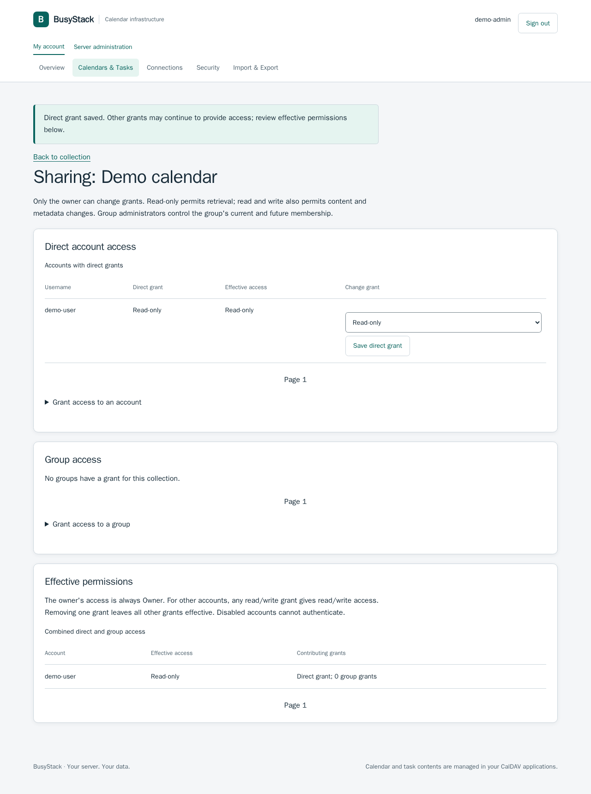

Owners choose **Manage sharing**, supply an exact recipient username or an available
group, then choose read-only or read/write access. Read-only permits reading;
read/write permits content changes. Only the owner manages sharing and deletes the
whole collection. Review effective access after changes; direct and group grants
combine. Clients may need rediscovery or a fresh synchronization after changes.

Deletion uses a separate review/confirmation screen and removes the collection,
contents, synchronization history, bindings and sharing grants. Export or obtain
an operator backup first if the data must be retained. If the form is stale, reload
and review current state instead of repeating a destructive submission.

## 12 — Connect applications

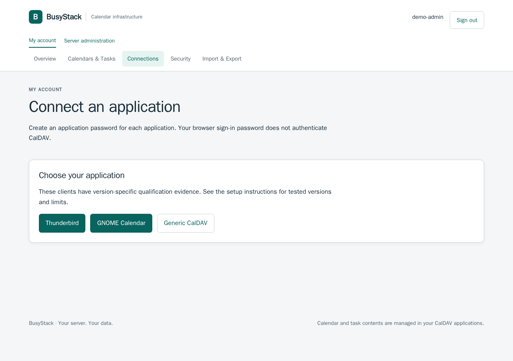

Open **Connections**, choose **Thunderbird**, **GNOME Calendar**, or **Generic CalDAV**.
The selected screen displays the configured server address, username and instructions.
Addresses include any configured subpath and come from deployment configuration.
Never remove the prefix or substitute an internal container hostname.

Choose **Create application password**. If verification expired, complete it, then
return to the form. Your BusyStack account password is **not** the ordinary DAV
client password.

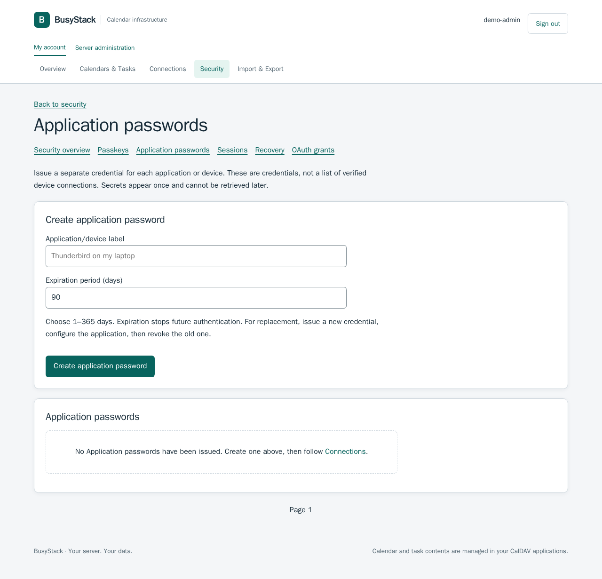

Enter an **Application/device label** such as “Thunderbird on my laptop”, and an
**Expiration period (days)** from 1 through 365. Choose **Create application password**.

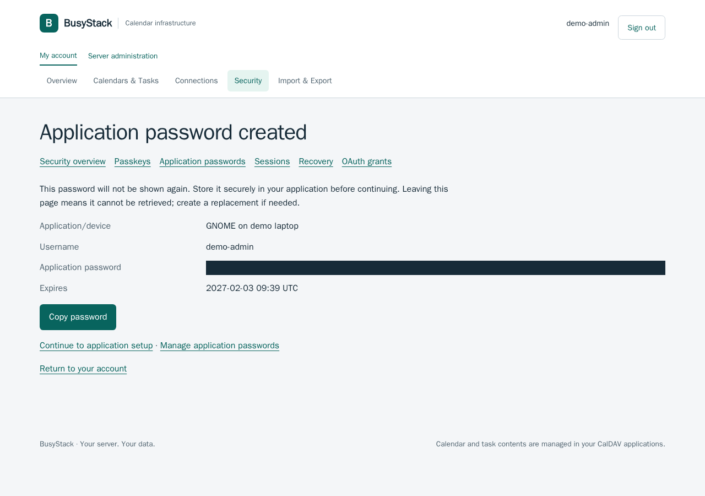

The screenshot is from the real confirmation page; the secret is deterministically
redacted during capture. The actual page shows label, username, password and expiry.
**The password will not be shown again.** Use **Copy password** and paste into the
client's password field or store securely before leaving. **Password copied.**
appears beside the action only if copying succeeded. If copying fails, select the
text manually and use your browser's Copy command. Username and server-address
copy actions give their own nearby status; no action moves keyboard focus.

Choose **Continue to application setup** to return to the chosen instructions.
Leaving the one-time screen means the secret cannot be retrieved. If lost, create
a replacement and revoke the previous password. Issuing a password does not prove
that an external application has connected; BusyStack does not track device setup.

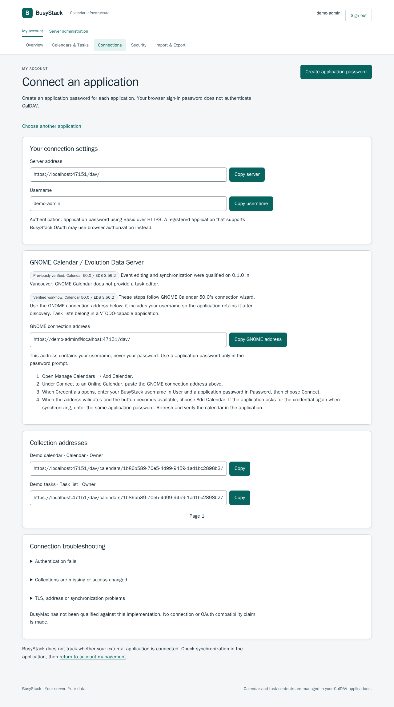

### Thunderbird

Version-scoped existing evidence covers Thunderbird 159.0 graphical workflows and
157.0.1 native-provider tests; final engineering evidence records which profiles
were rerun against this implementation. To configure:

1. Open Calendar and choose **New Calendar → On the Network**.
2. Enter the displayed username and server address as **Location**. Keep
   **This location doesn't require credentials** unchecked. Choose **Find Calendars**.
3. Enter the **application password**, not your primary BusyStack password, when
   prompted. Optionally retain it in Thunderbird's Password Manager.
4. Select CalDAV and the discovered calendars/task lists, then **Subscribe**.
   Use Thunderbird's task view for VTODO task lists.

Create a synthetic event and task, refresh, edit them, complete a task, and verify
changes from another authorized client/profile. Test deletion only on synthetic
data. After an application restart, confirm the data remains synchronized.

### GNOME Calendar / Evolution Data Server

Existing version-scoped evidence covers Calendar **50.0** / EDS **3.56.2**. Use the
portal's **GNOME connection address**, which includes your username but no password;
this wizard needs it to retain the authentication user after discovery.

1. Choose **Manage Calendars → Add Calendar**.
2. Paste that address under **Connect to an Online Calendar**.
3. In **Credentials**, enter your username in **User** and your application password
   in **Password**, then **Connect**.
4. After validation, choose **Add Calendar**. If synchronization prompts again,
   enter the same application password. Refresh and check a synthetic event.

GNOME Calendar has no task editor. Do not infer a task workflow from event discovery.
Existing EDS qualification is distinct from unqualified Evolution graphical setup.

### Generic CalDAV

Choose CalDAV/password authentication over HTTPS. Use the displayed server address,
username and application password. Discovery should show owned/shared collections.
If the application requires a collection URL, copy the appropriate address from
Connections. Task handling and wizard labels vary; an untested client is not
qualified merely because it offers a CalDAV field. BusyMax is not listed as a
verified connection option.

Use **Security → Application passwords** to review expiration/revocation metadata.
To replace a password, create a new one, update the client, then revoke the old one.
Revocation denies future authentication; a request already authorized may finish.
Registered OAuth-capable clients may instead use browser authorization with consent;
ordinary CalDAV discovery does not provide OAuth support automatically.

## 13 — Security management

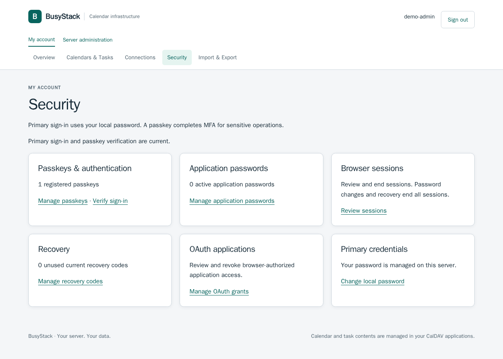

**Security** links to passkeys, application passwords, sessions, recovery, OAuth
grants and local-password changes. Sensitive actions require current primary and
passkey authentication. Sign out on shared computers. Sessions expire after thirty
minutes of inactivity; the ten-minute verification policy is separate.

Manage extra passkeys only after recent MFA. Labels are user-supplied descriptions,
not verified hardware/provider identities. Removing a passkey removes that stored
credential. Existing recent authentication remains governed by its ten-minute
factor lifetime; removal alone is not an account-wide security reset. If all
passkeys are removed, enroll/verify another before the next verification is needed.
Use controlled recovery if you cannot. Password changes and recovery invalidate
sessions/security generations and revoke independently issued access.

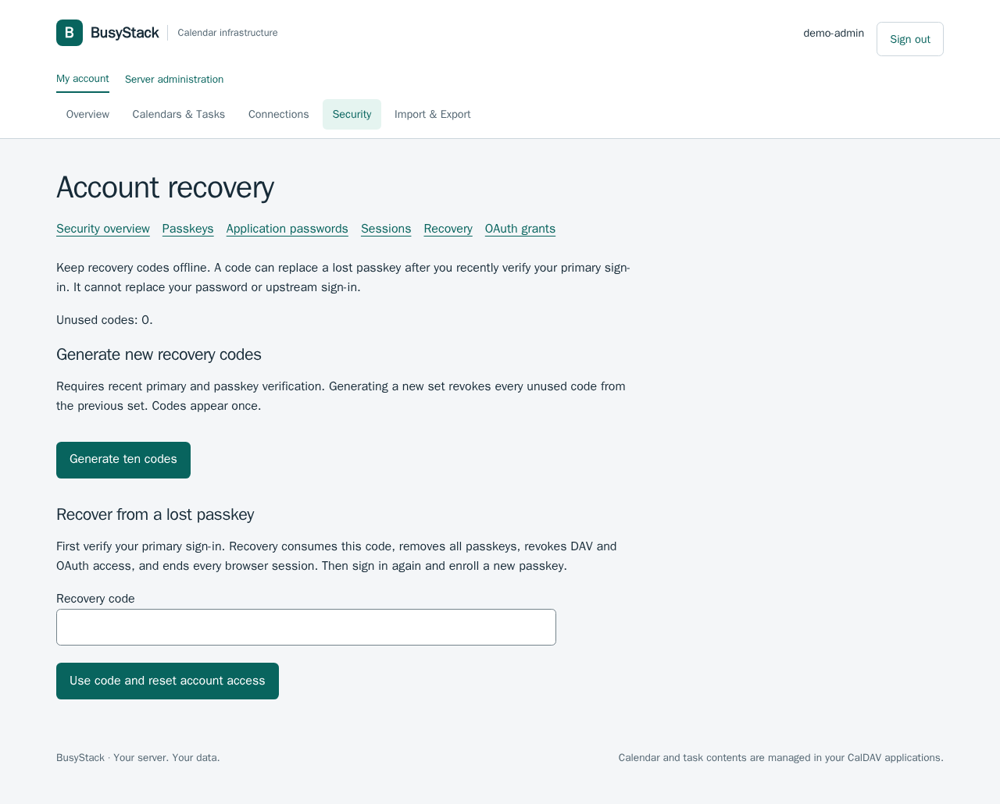

The real one-time code block is deterministically redacted in this screenshot.
Save your actual codes privately before leaving that screen.

After recent MFA, recovery generates ten high-entropy one-use codes, shown once,
expiring after one year. Save them privately offline. Generating a replacement set
revokes the prior unused set. A lost-passkey recovery submission needs recent
primary sign-in plus one unused code. Successful recovery revokes old passkeys,
client credentials/grants and browser sessions. Sign in again and enroll/verify a
new passkey. If primary sign-in is also lost, contact the operator; do not share
recovery codes with another user.

**Sessions** shows your sessions without bearer identifiers and allows revocation
of owned sessions after MFA. **OAuth applications** lists grants without tokens;
revoke unwanted access there. The account password-change form uses the same
14-character/72-byte policy. Organization-managed accounts change primary
credentials through their provider, with no local-password fallback.
[Account security](account-security.md) and [OAuth](oauth.md) explain exact limits.

## 14 — Import and export

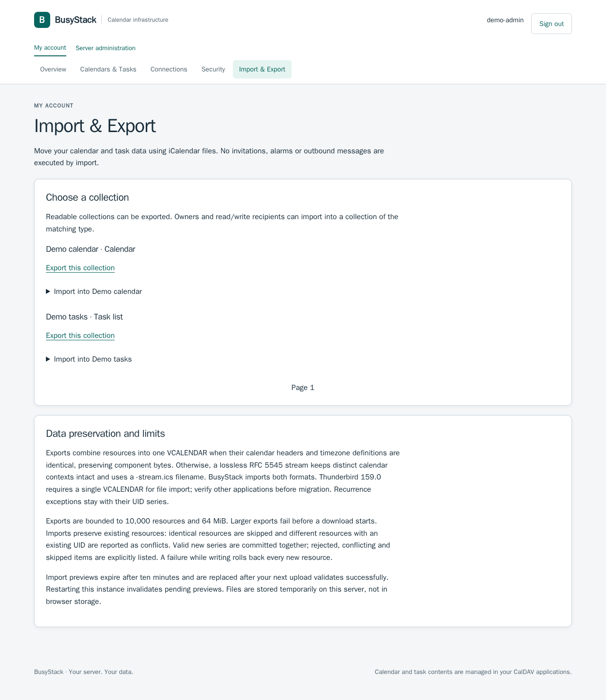

Use **Import & Export** with recent MFA. Select an authorized writable destination,
upload an iCalendar `.ics` file, review the preview, confirm, and inspect the result.
Calendars take VEVENT series; task lists take VTODO. Exceptions stay with their UID
series. At most **64 MiB**, **10,000 UID series/resources**, and **1 MiB per constructed
resource** are supported, with additional parsing/processing bounds.

New valid series are imported. Identical existing resources are skipped; different
content with the same UID conflicts and is preserved. There is no implicit merge
or overwrite. Preview and confirmation can differ if data/access changed. Database
failure rolls back writes; review the retained preview where offered. A preview
expires after ten minutes and does not survive restart. If outcome is uncertain,
inspect destination contents before uploading again. Invalid replacement uploads
preserve a previous valid preview. The portal provides a link to the current review.

Read-authorized users may export a collection. Matching calendar headers/timezones
produce one VCALENDAR; otherwise lossless export contains a stream of complete
VCALENDAR objects (`-stream.ics`). BusyStack can import both. Thunderbird 159.0's
native file importer does not consume multi-VCALENDAR streams; other clients may
also differ. Native CalDAV support does not establish file-import support.
An empty collection returns a notice instead of an unusable export. Operator
backups preserve more than an interchange file. See [portability](portability.md).

## 15 — Optional Keycloak

Keycloak is useful when an organization already operates an identity provider.
Standalone BusyStack works without it. Establish the first administrator through
chapter 6 before enabling federation. Keep an independently recoverable local
administrator for provider outages.

The operator registers an OIDC confidential client with authorization-code flow,
S256 PKCE and the exact callback `<PUBLIC_URL>/login/oauth2/code/upstream`. Disable
unused provider flows. Configure issuer, client ID, protected client secret and a
closed subject allowlist using [the complete Keycloak configuration](keycloak.md).
Compose has no mandatory Keycloak service. Mount protected operator configuration
and file-backed secrets through your deployment configuration; the detailed guide
provides the actual property names. Do not put provider secrets in a public file.

Allowlisted subjects are verified immutable issuer/subject identities, not emails
or matching display names. They provision ordinary local authorization identities.
Upstream roles do not grant BusyStack administrator privileges. Existing users may
explicitly link an organization identity only after recent MFA. Linking removes
local-password fallback, preserves local collection identity/passkeys, rotates the
security generation and revokes existing independent access.

Users choose organizational sign-in, then the same local passkey enrollment or
verification appropriate to actual account state. They do not configure Keycloak.
Organization sign-in requests fresh provider authentication (`prompt=login`,
`max_age=0`) and requires a recent verified authentication time. The ten-minute
primary-sign-in and passkey policy still applies to sensitive portal operations;
complete a fresh provider sign-in when primary authentication expires.
Provider tokens are not DAV passwords. BusyStack discards upstream access/refresh
tokens after login and uses its own application-access mechanisms.

Local login remains available during a provider outage. Managed users cannot fall
back to a local password. Already issued managed-user access may continue within
its existing freshness bound; an outage does not extend it. Default upstream
freshness is 24 hours (operator-configurable down to one minute). Upstream disabling
is not immediate push revocation of all BusyStack access; local disabling and local
revocation remain available. Recovery preserves the exact issuer/subject mapping.

## 16 — Backups and recovery

From the deployment directory, create a new private backup destination:

```sh
install -d -m 700 /private/backups
bash scripts/backup.sh /private/backups/busystack-before-update.dump
(cd /private/backups && sha256sum --check busystack-before-update.dump.sha256)
```

Replace `/private/backups` with an operator-owned backup directory. Expect
`Created database archive and checksum...` and a checksum `OK`. The script refuses
to overwrite an existing archive or checksum. Keep both files, configuration,
secret files and exact release/image identity securely, separately and preferably
off-host. Backups contain sensitive account/content/security state. A checksum
proves file integrity, not successful restoration; rehearse recovery.

Restore only into an **isolated empty deployment**, with a different project name
and port, its own correctly configured secrets, and every application instance
stopped. Do not restore over a production database. In that new extracted/configured
release directory:

```sh
docker compose config --quiet
docker compose pull --policy missing
docker compose up -d --no-build --wait database
bash scripts/restore.sh /private/backups/busystack-before-update.dump
```

The script checks the checksum, refuses a running application/nonempty target,
and accepts complete successful histories from V1 through V15. It preserves data,
ownership, shares and identity mappings, disables every account, changes recovery
and account epochs, removes restored sessions/passkeys/recovery codes/DAV credentials
and OAuth grants, revokes refresh families, and invalidates outstanding initialization
codes. An initialized database remains initialized. Expect the explicit restoration
and invalidation confirmation. On any failure keep the application stopped.

For an older supported schema, start the current image once with every account
disabled to apply forward migrations, then stop it before recovery:

```sh
docker compose up -d --no-build --wait --wait-timeout 240 application
docker compose stop application
```

After independently verifying each local user's identity, prepare an owner-only
file containing a **new** password. Use a password manager or protected local
editor; never put its value in command arguments. Mount it using the host owner's
UID so the owner-only permission check is meaningful:

```sh
docker compose run --rm --no-deps --user "$(id -u):$(id -g)" \
  --volume /private/path/new-password:/recovery-password:ro \
  application --spring.main.web-application-type=none \
  --busystack.recover-account=true \
  --busystack.recovery-username=administrator \
  --busystack.recovery-password-file=/recovery-password
```

Use the exact existing username and actual private absolute file path (mode 0600,
private parent). Recover accounts individually; never bulk-enable restored accounts.
Delete the temporary password file after securely recording the replacement.
Start the application, sign in and enroll fresh passkeys, then reissue application
access. Review restored administrator roles, sharing and OAuth registrations, which
may reflect old permissions. Verify actual event/task contents, rejected old
credentials, shared read/write boundaries, and fresh synchronization.

Externally managed accounts need provider-side recovery and the separate offline
command with their **existing exact** issuer/subject, without a replacement password:

```sh
docker compose run --rm --no-deps application \
  --spring.main.web-application-type=none \
  --busystack.recover-external-account=true \
  --busystack.recovery-username=organization-user \
  --busystack.recovery-issuer=https://identity.example.org/realms/organization \
  --busystack.recovery-subject=verified-existing-subject
```

Keep applications stopped during this operation. It does not change identity mapping
or create a local-password fallback. Follow [operations](operations.md#backup-and-isolated-restoration)
for recovery safeguards, ownership and verification scope. The established offline
bootstrap remains available only for an untouched empty database; ordinary new
installations use protected browser initialization.

## 17 — Updates

Read target release/migration notes. Back up and verify a restoration rehearsal
before updating. Obtain and verify the newer deployment archive as in chapter 3.
Keep the same intended Compose project/database volume, public URL and secret paths;
changing the extraction directory must not accidentally select a new project.
Copy your reviewed configuration into the new extracted package. Keep secret files
outside either package. Preserve optional operator overrides deliberately, reviewing
them against the new Compose file rather than replacing the new file wholesale.

From the old deployment directory stop the application. From the configured new
one validate, pull and start:

```sh
docker compose config --quiet
docker compose pull --policy missing
docker compose up -d --no-build --wait --wait-timeout 240
docker compose ps
```

Flyway validates published migration checksums and applies forward migrations.
This implementation adds V15 protected setup state after V1–V14. Existing accounts,
including disabled ones, close initialization on upgrade. Verify HTTPS, normal
returning-user sign-in, an existing calendar/task, sharing and synchronization.
Keep the previous artifact and backup for a controlled recovery plan; changing an
image does not undo database migrations. Automatic downgrade is not promised.

## 18 — Stopping and uninstalling

`docker compose stop` stops services while retaining containers and storage.
`docker compose up -d --no-build --wait` starts them again.
`docker compose down` removes this project's containers/network and retains the
database volume. Keep `.env`, secrets and proxy configuration to resume later.

**Destructive:** `docker compose down --volumes` also deletes this project's
persistent database. Run it only after independently verifying backups and
explicitly deciding to destroy that installation. Confirm the selected project
first with `docker compose ps`. It is not an update or ordinary restart command.

After deliberately uninstalling, remove the corresponding proxy configuration and
private configuration/secrets when no longer needed, following your retention
policy. Backups and copied secret material need separate secure disposal.

## 19 — Troubleshooting

Use the symptom to choose a safe check. Keep credentials, backups and detailed
infrastructure diagnostics private. Do not disable TLS, CSRF or passkey verification
to make an error disappear.

| Symptom | Supported causes and safe verification | Corrective action |
| --- | --- | --- |
| `docker version` cannot contact the daemon | Docker is stopped or operator access is unavailable. Check local service status and approved Docker permissions. | Start Docker using host administration; obtain authorized daemon access. Do not make its socket public. |
| Compose configuration fails | Required `.env` values/absolute secret files are missing, wrong working directory, or Compose is too old. | Run `docker compose config --quiet` in the extracted directory, check paths and Compose ≥2.24.4. |
| PostgreSQL stays unhealthy | Secret mount access, failed first initialization, storage or existing-role password mismatch. Check `docker compose ps` and private database startup logs. | Correct permissions/storage or coordinate role/secret rotation. Preserve the volume; changing a file alone does not rotate a role. |
| Application readiness fails | Database unavailable, invalid public URL/issuer, migration failure or resource limits. Check application startup logs and health status. | Correct the actual configuration/database problem and restart; do not edit applied migrations or bypass Flyway validation. |
| Browser/curl certificate error | Wrong hostname, expired/incomplete chain, or CA not trusted. Check the configured URL and certificate through normal client diagnostics. | Install/renew the correct chain and establish intended CA trust. Never disable validation. |
| Redirects or discovery use the wrong address | Wrong configured public URL/issuer or mismatched proxy prefix. Compare `.env`, proxy examples and Connections. | Set equal canonical URLs; preserve prefix; recreate application with `docker compose up -d --no-build --wait`. |
| `/calendar` links fail or discovery is missing | Prefix was stripped or host-root discovery mapping omitted. Check selected proxy example and `curl --head` discovery. | Restore the preserved prefix and explicit well-known mappings; validate proxy before reload. |
| Initialization code is unavailable | Expired, replaced, used, absent or invalidated after repeated failures. It is intentionally not distinguished publicly. | Issue a replacement locally with `bash scripts/initialize.sh`, then re-enter it within 15 minutes. |
| Local initialization refuses after setup | Database already has initialization/account history. Check normal sign-in and your deployment project. | Use ordinary sign-in or controlled recovery. Never delete accounts/setup state to reopen registration. |
| Login fails | Incorrect local credentials, disabled account, wrong primary method or throttle cooldown. | Check username/manager entry, use organization sign-in for managed accounts, allow cooldown, or ask the administrator/operator for controlled recovery. |
| Passkey prompt does not appear | Insecure/wrong URL, unavailable browser capability/provider or expired primary sign-in. | Use configured HTTPS in a supported browser, unlock the intended provider, check account status and sign in again if needed. |
| Prompt closes or reports interaction incomplete | Cancellation, timeout or no available credential can produce the same browser error. | Retry deliberately, select this account's passkey, or use recovery. Do not assume every error is cancellation. |
| Challenge expired/already used | Ceremony exceeded five minutes or was submitted again/from stale state. | Request a fresh prompt. Never replay an old assertion. |
| Network failed after enrollment | Server may have committed while its response was lost. | Use **Check account status**; if enrolled, verify the saved passkey. Review management before creating another. |
| MFA expires while a page remains open | Ten-minute factors expired independently of session idle timeout. | Follow the contextual sign-in/verification action, return to the intended page, and review/resubmit forms yourself. |
| Session invalidated | Password change, recovery, disabling or epoch change ended access. | Sign in again; contact administrator if disabled. A stale page cannot authorize a protected mutation. |
| Application password rejected | Account password used instead, wrong username, expired/revoked password, disabled account or managed-user upstream freshness expired. | Check metadata in Security; issue a replacement after MFA, update client, revoke old access; managed users may need organization sign-in. |
| Client discovers no calendars | No collection/shared grant, wrong URL/prefix, discovery route or client-specific username retention. | Check Calendars & Tasks and configured address; use GNOME's username-bearing address; ask owner to review effective access and refresh discovery. |
| Keycloak unavailable | Provider discovery/login cannot complete. Local startup remains independent. | Restore the provider/certificate/configuration. Use a local administrator for operator work; managed users have no password fallback. Existing freshness is not extended. |
| Import rejected or busy | Wrong collection type, invalid file, UID conflict, 64 MiB/10,000-series/1 MiB-resource bounds, processing budget or temporary capacity. | Read preview/error, preserve original, correct/split the migration, discard an unused preview or retry later. Never assume a conflict overwrote data. |
| Import preview expired after restart | Preview tokens are temporary and do not survive restart. | Check destination if an outcome was uncertain, upload again, review and confirm the new preview. |
| Backup refuses to overwrite | Archive or `.sha256` already exists. | Choose a new private filename. Preserve the earlier backup. |
| Restore refuses running/nonempty target | Safety checks protect existing data. | Stop all application instances and use a separately configured empty database/project. Never remove production data to satisfy the check. |
| Restore reports unsupported/failed/gapped history | Archive history is outside reviewed schema V1–V15 or invalid. | Keep application stopped; use the matching reviewed recovery procedure and original archive. Do not suppress the check. |
| Restored accounts cannot sign in | Restore deliberately disables accounts and revokes credentials. | Independently verify each user and run the documented local/external recovery command, then re-enroll factors. |

For deeper reference: [operations](operations.md), [portal](portal.md),
[administration](administration.md), [passkeys](passkeys-and-mfa.md),
[account security](account-security.md), [Keycloak](keycloak.md),
[OAuth](oauth.md), [groups](groups.md), and [portability](portability.md).
